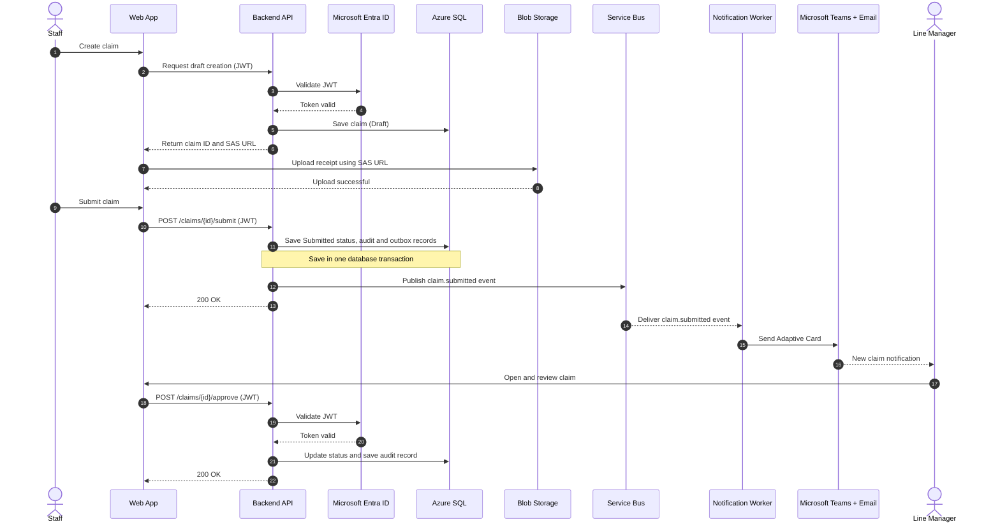
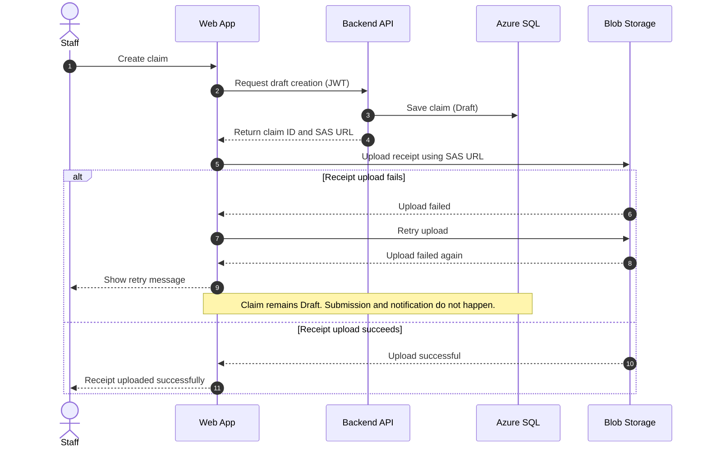

# 4. Sequence Diagram — Submit and Approve a Claim

### 4.1. Happy Path

1. Staff creates a claim.
2. The Backend API generates a SAS URL.
3. The Web App uploads receipts directly to Blob Storage.
4. Staff submits the claim.
5. The API saves the claim, audit, and notification outbox records in Azure SQL.
6. The API publishes an event to Service Bus.
7. The Notification Worker sends a Teams notification to the Line Manager.
8. The Line Manager reviews and approves the claim through the Web App.
9. The API updates the claim status and saves an audit record in Azure SQL.

## Happy Path

### 4.2. Error Path — Receipt Upload Fails

This describes what happens when a receipt upload fails.

1. The claim remains in Draft status in the database.
2. If the upload fails, the Web App retries the upload.
3. If the retry also fails, the claim remains in Draft status.
4. The claim is not submitted.
5. No notification is sent to the Line Manager.

## Error Path — Receipt Upload Failure

